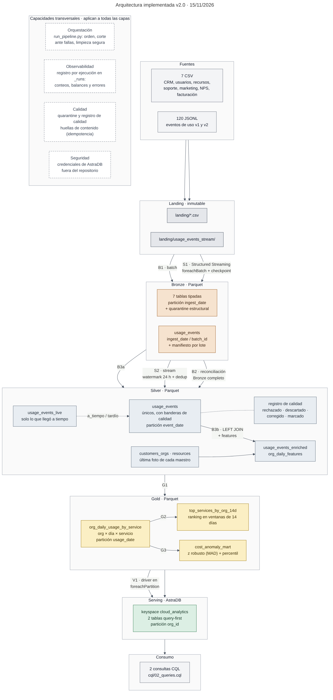

# TP-BigData-CloudProviderAnalytics

Proyecto integrador · **Big Data (72.80) · ITBA · 2.º cuatrimestre 2026** · Prof. Diego Mosquera

Pipeline de datos para un proveedor de nube. Ingesta datos en batch y en streaming, los procesa con PySpark en un
Data Lake en Parquet (Landing → Bronze → Silver → Gold) y publica marts para **FinOps, Soporte y Producto/Usage**
en Cassandra/AstraDB.

## Integrantes

- Stephanie Amairany Castillo Avendaño
- Gianluca Giannine Lizarraga
- Agustín Ezequiel Pagani
- Tomas Lautaro Reymundo
- Antonio Uriel Serrano Jaimes

## Estado

| Instancia | Foco | Estado |
|---|---|---|
| Entrega 1 · 05/10/2026 | Diseño y fundación de datos | Entregada (diseño v1.1 y exploración) |
| Entrega 2 · 16/11/2026 18:30 | Implementación técnica end-to-end mínima | Entregada: pipeline completo de Landing a AstraDB |
| Final · 07/12/2026 21:30 | MVP integrado y defensa | ⬜ |

Correcciones de la entrega 1 y plan de la entrega 2: [`docs/entrega2/`](docs/entrega2/).

## Arquitectura implementada (entrega 2)



El detalle está en [`docs/entrega2/arquitectura_v2.md`](docs/entrega2/arquitectura_v2.md): flujo de eventos
(streaming, watermark, datos tardíos y calidad), cambios respecto de la entrega 1, particiones, claves de
Cassandra y umbrales.

## Quickstart (entrega 2)

Lo probamos en **Linux o WSL2 (Ubuntu) con Python 3.11 y Java 17**. En Windows conviene usar WSL2: sin
`winutils.exe` Spark no escribe Parquet, y los workers de Python pueden terminar llamando al alias de Microsoft Store.

### 1. Preparar el entorno (una sola vez)

En Windows, primero instalá WSL2 desde PowerShell como administrador (`wsl --install -d Ubuntu`), reiniciá y
abrí la terminal de Ubuntu. Después, en Linux o en Ubuntu:

```bash
sudo apt update && sudo apt install -y openjdk-17-jdk software-properties-common git unzip
sudo add-apt-repository -y ppa:deadsnakes/ppa && sudo apt install -y python3.11 python3.11-venv
mkdir -p ~/projects && cd ~/projects        # en WSL: dentro de Linux, no en /mnt/c (es mucho más lento)
git clone https://github.com/Sstark0/TP-BigData-CloudProviderAnalytics.git
cd TP-BigData-CloudProviderAnalytics
python3.11 -m venv .venv && source .venv/bin/activate
pip install -r requirements.txt
```

Para editar con VS Code desde WSL, ejecutá `code .` en la carpeta del repo (requiere la extensión *WSL*).

### 2. Copiar el dataset

El dataset no se versiona (ver [`data/README.md`](data/README.md)). Copiá el contenido de su `datalake/landing/`
dentro de `datalake/landing/` del repo. Desde WSL, si el ZIP se descomprimió en Descargas:

```bash
cp -r "/mnt/c/Users/<usuario>/Downloads/<dataset>/datalake/landing/." datalake/landing/
ls datalake/landing/                         # 7 CSV y la carpeta usage_events_stream/ (120 JSONL)
```

### 3. Ejecutar las pruebas y el pipeline completo

```bash
source .venv/bin/activate
python scripts/run_pipeline.py --clean --tests --operador "Tu nombre"
```

- **Duración:** unos 8 minutos, 2,5 de ellos de pruebas.
- **Qué hace:** corre las 67 pruebas, vacía las zonas derivadas y ejecuta las nueve etapas en orden (control de Landing, Bronze batch, Bronze streaming, Silver de eventos, enriquecimiento, reporte de calidad, Gold, anomalías y AstraDB). Si una etapa falla, se corta ahí.
- **Registro:** `evidence/entrega2/e2_12_pipeline_run.json` guarda quién lo corrió, el entorno, las pruebas y los conteos de cada etapa. La salida completa queda en `datalake/_runs/pipeline/<run_id>/`.
- **AstraDB:** si no hay credenciales, esa etapa se saltea (y queda registrado) y el resto corre igual. Ver el paso 4.

### 4. AstraDB (etapa de serving)

1. En [astra.datastax.com](https://astra.datastax.com), creá una base **Serverless (non-vector)** con el keyspace `cloud_analytics`.
2. Generá un token (pestaña *Overview*, *Generate Token*) y descargá el *Secure Connect Bundle*. Pasos detallados en D-17.
3. Guardá las credenciales **fuera del repo** (el repo es público):

```bash
mkdir -p ~/.astra && chmod 700 ~/.astra
cp /mnt/c/Users/<usuario>/Downloads/secure-connect-*.zip ~/.astra/
cat > ~/.astra/astra.env <<'EOF'
export ASTRA_DB_KEYSPACE=cloud_analytics
export ASTRA_DB_REGION=<región>
export ASTRA_DB_APPLICATION_TOKEN=<token AstraCS:...>
export ASTRA_SECURE_BUNDLE_PATH=$HOME/.astra/<archivo secure-connect>.zip
EOF
chmod 600 ~/.astra/astra.env
set -a; source ~/.astra/astra.env; set +a          # en cada terminal nueva
python scripts/run_pipeline.py --desde serving_astra
```

Las bases del plan Free **hibernan** después de 48 h sin uso: antes de una demo, entrá al portal y hacé clic en *Resume*.
Las dos consultas para el CQL Console están en [`cql/02_queries.cql`](cql/02_queries.cql).

### Salida esperada

| Capa | Resultado |
|---|---|
| Landing | 7 CSV (4.112 filas) y 120 JSONL (43.200 eventos) |
| Bronze | 4.112 filas y 43.200 eventos, sin rechazos estructurales |
| Silver | 43.200 eventos únicos: 1.439 a tiempo por el stream y 41.761 tardíos recuperados. 2.038 unidades inferidas y 211 costos negativos marcados |
| Features | 4.580 filas organización × día; costo total USD 147.433,98 |
| Gold | 11.050 filas organización × día × servicio (huella de contenido `144780998816`) y 15.599 filas de ranking |
| Anomalías | 222 spikes (34 de 34 spikes conocidos) y 208 días con costos negativos |
| AstraDB | 11.050 + 15.599 filas, iguales a Gold; 2 consultas iguales a Spark |

### Etapas sueltas y opciones

También se puede correr cada script de `scripts/` por separado, en este orden: `check_common.py`, `run_bronze_batch.py`,
`run_bronze_streaming.py`, `run_silver_events.py`, `run_silver_enrichment.py`, `report_quality.py`,
`run_gold_finops.py`, `run_cost_anomalies.py` y `run_serving_astra.py`. Cada uno usa lo que dejó el anterior, así que
si cambia una capa hay que volver a correr las siguientes. Para eso está `run_pipeline.py --desde <etapa>`.

| Opción de `run_pipeline.py` | Efecto |
|---|---|
| `--tests` | Corre las pruebas antes; si fallan, no ejecuta el pipeline |
| `--clean` | Vacía `bronze/`, `silver/`, `gold/`, `quarantine/` y `_checkpoints/`. Nunca toca `landing/` ni `_runs/` |
| `--desde` / `--hasta` | Ejecuta solo un tramo de etapas |
| `--sin-serving` | Omite la carga en AstraDB |
| `--actualizar-evidencias` | Cada etapa reescribe su evidencia en `evidence/entrega2/`; por defecto va a `_runs/pipeline/<run_id>/evidence/` |

### Limpieza y reinicio

- **Reconstruir el lago desde cero:** `python scripts/run_pipeline.py --clean`. Landing es inmutable y nunca se borra.
- **Re-ejecutar sin limpiar:** no duplica nada. El streaming sigue desde su checkpoint, Silver y Gold se recalculan completos y AstraDB reescribe por clave y borra lo que ya no está en Gold (D-13, D-16, D-17).

### Problemas frecuentes

| Síntoma | Causa y solución |
|---|---|
| `WARN Utils: Your hostname ... resolves to a loopback address` | Aviso de Spark sin efecto. Para ocultarlo: `export SPARK_LOCAL_IP=127.0.0.1` |
| En las pruebas aparece `ERROR ... fallo simulado` | Es intencional: una prueba verifica que el registro guarde los errores. Lo que cuenta es el `OK` final |
| `Falta X: ejecutá antes scripts/...` | Una etapa necesita la salida de la anterior: usá `run_pipeline.py --desde <esa etapa>` |
| `Faltan variables de entorno: ASTRA_...` | Falta `set -a; source ~/.astra/astra.env; set +a` en esa terminal |
| Timeout o `NoHostAvailable` contra AstraDB | La base hiberna: *Resume* en el portal y esperar a que diga *Active* |
| En Windows: `Python worker failed to connect back` o falta `winutils.exe` | Usar WSL2 (paso 1) |


## Estructura del repositorio

```
.
├── README.md              ← este archivo
├── DECISIONS.md           ← decisiones técnicas (D-01 … D-19), alternativas y trade-offs
├── requirements.txt       ← dependencias de Python (Python 3.11)
├── config/                ← configuración de ejemplo (.env.example), sin credenciales
├── cql/                   ← esquema y consultas de Cassandra/AstraDB
├── data/                  ← cómo obtener el dataset + muestra chica versionada
├── datalake/              ← zonas del lago; los datos NO se versionan
│   ├── landing/           ←   datos originales, inmutables
│   └── bronze/ silver/ gold/ quarantine/ _checkpoints/ _runs/
├── docs/                  ← diseño (entrega 1), correcciones y plan (entrega 2), diagramas
├── notebooks/             ← exploración (01_exploracion_fuentes.ipynb)
├── scripts/               ← un script por etapa + run_pipeline.py
├── src/
│   ├── common/            ←   rutas, sesión Spark, esquemas, lectura, registro de ejecuciones
│   ├── batch/             ←   Bronze batch, Silver de eventos, maestros y features
│   ├── streaming/         ←   S1 (Landing → Bronze) y S2 (Bronze → Silver con watermark)
│   ├── gold/              ←   mart FinOps, ranking y anomalías
│   └── serving/           ←   carga y consultas en Cassandra/AstraDB
├── tests/                 ← pruebas automáticas (python -m unittest discover -s tests)
├── infra/                 ← entorno de ejecución (Docker diferido, ver D-01)
└── evidence/              ← resultados de ejecución por entrega
```

## Entrega 1 · 05/10/2026

Diseño integrado v1.1: [Markdown](docs/entrega1/diseno_integrado.md) y [PDF](docs/entrega1/diseno_integrado.pdf) y [Word editable](docs/entrega1/diseno_integrado.docx).
Matriz: [Markdown](docs/entrega1/matriz_requisitos.md). Plan: [Markdown](docs/entrega1/plan_inicial.md).
Verificación y cierre: [cambios y validación](evidence/entrega1/VERIFICACION_2026-10-05.md) y [cierre](evidence/entrega1/CIERRE.md).

La entrega 1 era de diseño: la arquitectura era una propuesta y todavía no había pipeline, streaming ni Cassandra.
La evidencia de esa etapa se conserva con sus fechas.

## Quickstart (entrega 1: exploración de datos)

### Google Colab (alternativa por validar)
No lo probamos en Colab, solo en local con Python 3.11. Antes de usarlo, verificar que la versión de Python sea compatible con Spark 3.5.

1. Clonar o descargar este repositorio.
2. Copiar el dataset del docente dentro de `datalake/landing/` (ver [`data/README.md`](data/README.md)).
3. Subir la carpeta completa `TP-BigData-CloudProviderAnalytics/` a la raíz de Google Drive (*Mi unidad*). Si está en otro lugar, definir `PROJECT_ROOT` en una celda antes de la preparación.
4. En Drive, abrir `notebooks/01_exploracion_fuentes.ipynb` con **Google Colaboratory**.
5. *Entorno de ejecución → Ejecutar todas*. La primera celda pide permiso para conectar Drive e instala PySpark.

### Local (entorno validado)
Requisitos: **Python 3.11** (evitar Python3.14 con Spark3.5), **Java 11 o 17** (Spark corre sobre Java; no se instala con pip) y PySpark 3.5.x.
```bash
git clone https://github.com/Sstark0/TP-BigData-CloudProviderAnalytics.git
cd TP-BigData-CloudProviderAnalytics
python3.11 -m venv .venv
source .venv/bin/activate             # Windows: .venv\Scripts\activate
pip install -r requirements.txt
# Copiar el dataset dentro de datalake/landing/ (ver data/README.md)
python -m ipykernel install --user --name python3
python scripts/run_exploration.py
# Alternativa interactiva: jupyter notebook notebooks/01_exploracion_fuentes.ipynb
```

Si el dataset está fuera del repo, exportar `LANDING_PATH=/ruta/absoluta/datalake/landing` antes de ejecutar. Con `EVIDENCE_DIR` se puede guardar la evidencia en otra carpeta (va a la subcarpeta `entrega1/`). El `.env.example` solo documenta las variables: no se carga solo.

**Salida esperada:** tablas de perfil en el notebook y `evidence/entrega1/perfil_fuentes.json`
(43.200 eventos, 120 archivos, 0 `event_id` duplicados).

**Limpieza / reinicio:** el notebook solo lee Landing; para regenerar la evidencia basta con volver a ejecutarlo.

## Convenciones

| Tema | Convención |
|---|---|
| Idioma | Documentación en español; código, columnas y rutas en inglés `snake_case` |
| Zonas | `landing` (inmutable) → `bronze` → `silver` → `gold`; rechazados y correcciones en `quarantine` |
| Tiempo | Todo en **UTC** |
| Columnas técnicas | `source_file`, `ingest_ts`, `run_id` desde Bronze; `batch_id` en eventos |
| Ejecuciones | Cada proceso deja su registro en `datalake/_runs/<proceso>/<run_id>.json`, con conteos y balances |
| Configuración | Variables de entorno (`config/.env.example`); nunca credenciales en el repo |
| Commits | `tipo(ámbito): mensaje`; tipos: `feat`, `docs`, `chore`, `fix` |
| Ramas | `main` siempre entregable; `entrega2` integra; un paquete por rama `e2/<paquete>`, revisada antes de integrar |


## Documentación

- Diseño de la entrega 1: [`docs/`](docs/README.md)
- Correcciones y plan de trabajo de la entrega 2: [`docs/entrega2/`](docs/entrega2/)
- Arquitectura implementada: [`docs/entrega2/arquitectura_v2.md`](docs/entrega2/arquitectura_v2.md)
- Gobierno preliminar: [`docs/entrega2/gobierno.md`](docs/entrega2/gobierno.md) · catálogo de datos: [`docs/entrega2/catalogo_datos.md`](docs/entrega2/catalogo_datos.md)
- Backlog final priorizado: [`docs/entrega2/backlog.md`](docs/entrega2/backlog.md)
- Registro de decisiones: [`DECISIONS.md`](DECISIONS.md)
- Evidencia: [`evidence/entrega1/`](evidence/entrega1/README.md) y [`evidence/entrega2/`](evidence/entrega2/), con un JSON por paquete y las capturas de AstraDB


## Validación conservada

- 02/10: runner y notebook ejecutado, según evidencia versionada.
- 04/10: las 19 celdas funcionales se ejecutaron en orden con Spark en un proceso Python directo; el runner Jupyter quedó bloqueado al iniciar kernel por restricciones de puertos/ZeroMQ del entorno usado.
- 05/10: correcciones y pruebas de regresión documentadas en [verificación del 05/10](evidence/entrega1/VERIFICACION_2026-10-05.md).
- Colab: sin probar.

Para reproducir los números documentados hay que usar el dataset completo. La muestra de `data/sample/` sirve para probar que corre (tiene un solo JSONL), pero no mantiene las relaciones entre tablas ni da los mismos totales. Los percentiles aproximados pueden variar un poco entre corridas. Más detalle en `evidence/entrega1/VERIFICACION_2026-10-04.txt`.

## Pruebas de regresión

Con el entorno local activado y Java disponible:
```bash
python -m unittest discover -s tests -v
```
Las pruebas cubren evidencia externa y simulación temporal con uno o varios archivos. La prueba de ruta del runner simula la ejecución del kernel; no reemplaza la ejecución real del notebook.
