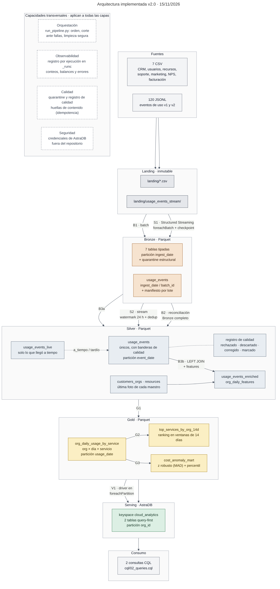
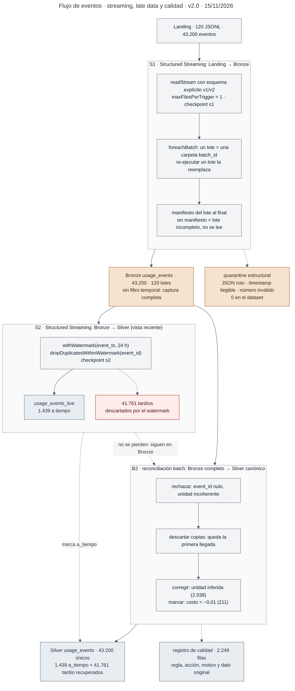

# Arquitectura implementada · v2.0

**Fecha:** 15/11/2026 · **Entrega:** 2 · **Reemplaza a:** arquitectura propuesta v1.1 del 05/10/2026 ([`docs/entrega1/arquitectura.svg`](../entrega1/arquitectura.svg))

Este documento describe lo que **está implementado y se ejecuta** con `python scripts/run_pipeline.py`. Los
diagramas no muestran componentes planificados para la entrega final; esos están en el backlog.

Cada diagrama está en [`docs/diagramas/`](../diagramas/) en tres formatos: `.mmd` (fuente Mermaid, editable),
`.png` (alta resolución, el que se usa en los documentos y la presentación porque se ve igual en cualquier visor)
y `.svg` (escalable, para abrir en el navegador). Para regenerarlos:
`mmdc -i arquitectura_v2.mmd -o arquitectura_v2.png -b white -s 2`.

## 1. Vista general

| Proceso | Qué hace | Script | Decisión |
|---|---|---|---|
| B1 | 7 CSV de Landing a Bronze tipado, con quarantine estructural y conciliación | `run_bronze_batch.py` | D-11 |
| S1 | Eventos JSONL a Bronze con Structured Streaming: `foreachBatch`, checkpoint, manifiesto por lote | `run_bronze_streaming.py` | D-04, D-12 |
| S2 | Bronze a `silver/usage_events_live` en streaming: watermark de 24 h y dedup por `event_id` | `run_silver_events.py` | D-13 |
| B2 | Bronze completo a `silver/usage_events`: reglas de calidad, dedup, recuperación de tardíos | `run_silver_events.py` | D-13, D-15 |
| B3a | Última foto de `customers_orgs` y `resources` en Silver | `run_silver_enrichment.py` | D-14 |
| B3b | Eventos enriquecidos (LEFT JOIN) y features diarias por organización | `run_silver_enrichment.py` | D-14 |
| G1 | Mart FinOps `org_daily_usage_by_service` (org × día × servicio) | `run_gold_finops.py` | D-16 |
| G2 | Ranking de servicios por costo en ventanas móviles de 14 días | `run_gold_finops.py` | D-17 |
| G3 | `cost_anomaly_mart`: z-score robusto (MAD) y percentil para arranque en frío | `run_cost_anomalies.py` | D-18 |
| V1 | Carga en AstraDB desde Spark y dos consultas CQL | `run_serving_astra.py` | D-17 |
| — | Orquestación, corte ante fallas, limpieza y registro de ejecución | `run_pipeline.py` | D-19 |
| — | Demostración de idempotencia: conteos y huellas antes y después | `check_idempotency.py` | D-20 |

**Patrón: híbrido** (D-03, validado en esta entrega).
- Los **maestros y la facturación** van por batch (B1).
- Los **eventos** entran por streaming (S1). Desde Bronze salen dos caminos: una **vista reciente** por streaming con watermark (S2) y el **histórico canónico** por reconciliación batch (B2), que recupera lo que el watermark descarta.
- No es Lambda clásica: no hay dos implementaciones de la misma lógica, y la vista reciente no alimenta a Gold. Tampoco es Kappa pura: los CSV mensuales no se tratan como streams.

## 2. Flujo de eventos: streaming, late data y calidad

El checklist de la consigna pide "streaming con esquema, watermark, dedupe, late data y checkpoint". Lo cubre la
cadena de **dos consultas de Structured Streaming**, S1 y S2, más la reconciliación B2 para los tardíos:

| Requisito | Dónde | Evidencia |
|---|---|---|
| Esquema explícito | S1: `EVENTS_RAW_SCHEMA`, superset v1/v2 (D-05) | `e2_03_bronze_streaming.json` |
| Checkpoint | S1 (`_checkpoints/s1_bronze_events`) y S2 (`_checkpoints/s2_silver_events_live`) | `e2_10_idempotency.json`: 0 lotes nuevos al re-ejecutar |
| Watermark | S2: `withWatermark("event_ts", "24 hours")` | `e2_04_silver_events.json`: 41.761 descartados |
| Dedupe | S2: `dropDuplicatesWithinWatermark("event_id")`; B2: primera llegada por `event_id` | `e2_04`, `e2_06` |
| Late data | B2 recupera los 41.761 tardíos desde Bronze; `arrival_path` indica el camino | `e2_04_silver_events.json` |

## 3. Qué cambió respecto de la arquitectura propuesta v1.1

| v1.1 (propuesta) | v2.0 (implementada) | Por qué | Decisión |
|---|---|---|---|
| Bronze de eventos en `events/dt=<fecha del evento>` | `usage_events/ingest_date=<carga>/batch_id=<lote>` | Cada archivo trae casi 60 días de eventos: serían 7.180 archivos chicos en vez de 120, y re-ejecutar un lote tocaría hasta 60 particiones | D-12 |
| Un solo camino de streaming con watermark | S1 (captura completa) + S2 (watermark y dedup) + B2 (histórico) | El watermark descarta el 97 % de los eventos con el orden real de llegada; el histórico no puede depender de él | D-13 |
| Gold con micro-lotes provisionales y reconciliación diaria | Gold se calcula solo desde Silver canónico; la vista reciente queda en Silver | Gold provisional obligaría a conciliar dos versiones del mismo mart; la vista reciente cubre la necesidad de baja latencia | D-13, D-16 |
| Quarantine para registros inválidos | Registro de calidad con acción: rechazado, descartado, corregido o marcado | Rechazar 2.038 eventos sin unidad haría perder USD 7.106 de un dato reconstruible | D-15 |
| Cassandra query-first (sin modelo) | 2 tablas con partición `org_id`; ranking precalculado para el Top-N | Cassandra no agrupa ni ordena por columnas que no son de clustering | D-17 |
| Anomalías como flag por validar | `cost_anomaly_mart` con MAD, umbrales y evaluación | La consigna pide método justificado, métricas y limitaciones | D-18 |
| Sin orquestación | `run_pipeline.py` con corte ante fallas, limpieza y registro | Etapas dependientes; en E2-07 se ejecutó Gold sobre datos viejos | D-19 |

## 4. Particiones y archivos

Medido sobre el lago después de `run_pipeline.py --clean`. Los volúmenes son chicos y ninguna tabla genera
archivos vacíos: `spark.sql.shuffle.partitions = 8` (D-07) y un archivo por partición.

| Tabla | Partición | Archivos | Tamaño | Por qué esa partición | Decisión |
|---|---|---:|---:|---|---|
| `bronze/<7 maestros>` | `ingest_date` | 1 c/u | 4–25 KB | Una foto por carga; re-ejecutar el mismo día reemplaza la partición | D-11 |
| `bronze/usage_events` | `ingest_date` / `batch_id` | 120 | 3,1 MB | Un lote = una carpeta: re-ejecutar un lote solo reemplaza la suya | D-12 |
| `silver/usage_events` | `event_date` | 60 | 2,6 MB | Las consultas y los marts filtran por fecha del evento | D-13 |
| `silver/usage_events_live` | sin partición (sink de streaming) | 120 | 0,7 MB | Sink exactly-once de Spark: un archivo por micro-lote | D-13 |
| `silver/usage_events_enriched` | `event_date` | 60 | 3,0 MB | Igual que Silver de eventos | D-14 |
| `silver/org_daily_features` | sin partición | 1 | 140 KB | 4.580 filas: particionar solo crearía archivos diminutos | D-14 |
| `silver/customers_orgs`, `resources` | sin partición | 1 c/u | 7–12 KB | Maestros chicos, se leen enteros | D-14 |
| `quarantine/source=usage_events_silver` | `dt` (fecha de carga en Bronze) | 1 | 200 KB | Contrato de quarantine de E1 | D-15 |
| `gold/org_daily_usage_by_service` | `usage_date` | 60 | 0,8 MB | Contrato de E1 (`dt=`) y consultas por rango de fechas | D-16 |
| `gold/top_services_by_org_14d` | sin partición | 1 | 140 KB | Solo se usa para cargar Cassandra | D-17 |
| `gold/cost_anomaly_mart` | `usage_date` | 60 | 1,1 MB | Mismo grano y partición que el mart que evalúa | D-18 |

## 5. Claves de Cassandra (keyspace `cloud_analytics`, AstraDB, AWS us-east-2)

| Tabla | Clave de partición | Clustering | Consulta que resuelve | Filas |
|---|---|---|---|---:|
| `org_daily_usage_by_service` | `org_id` | `usage_date DESC, service ASC` | Costos y requests diarios de una organización en un rango de fechas | 11.050 |
| `top_services_by_org_14d` | `org_id` | `window_end_date DESC, cost_rank ASC` | Top-N servicios por costo en los últimos 14 días (`LIMIT N`) | 15.599 |

Las dos consultas leen una sola partición y no usan `ALLOW FILTERING`. Esquema: [`cql/01_schema.cql`](../../cql/01_schema.cql).
Consultas: [`cql/02_queries.cql`](../../cql/02_queries.cql). Capturas: [`evidence/entrega2/capturas/`](../../evidence/entrega2/capturas/). Detalle en D-17.

## 6. Umbrales y parámetros

| Parámetro | Valor | Dónde | Por qué | Decisión |
|---|---|---|---|---|
| Watermark de eventos | 24 h (`EVENTS_WATERMARK`) | S2 | Tolerancia de retraso de la vista reciente; lo que llega más tarde lo recupera B2 | D-04, D-13 |
| Archivos por micro-lote | 1 (`MAX_FILES_PER_TRIGGER`) | S1, S2 | Simula la llegada archivo por archivo | D-12 |
| Tolerancia de costo negativo | −0,01 USD | B2 | Negativos menores son redondeo; por debajo, el evento se marca | D-15 |
| Unidad esperada por métrica | `requests`→`count`, `cpu_hours`→`hours`, `storage_gb_hours`→`gb_hours` | B2 | Perfil de E1: ninguna unidad informada contradice a su métrica | D-15 |
| z robusto para spike | > 3,5 | G3 | Referencia de Iglewicz y Hoaglin | D-18 |
| Exceso mínimo (materialidad) | USD 5 | G3 | Saltos de centavos no son relevantes para FinOps | D-18 |
| Ventana de línea base | 28 días anteriores | G3 | Cuatro semanas, sin mirar el futuro | D-18 |
| Historia mínima | 7 días | G3 | Con menos, mediana y MAD no son estables | D-18 |
| Arranque en frío | p99 del costo diario del servicio | G3 | Respaldo para los primeros días de cada serie | D-18 |
| Ventana del ranking | 14 días | G2 | La consigna pide los últimos 14 días | D-17 |

## 7. Entorno y ejecución

Validado en WSL2 (Ubuntu) con Python 3.11, Java 17, PySpark 3.5.3 y `cassandra-driver` 3.30.1
(`evidence/entrega2/e2_12_pipeline_run.json`). Una ejecución completa desde cero tarda unos 8 minutos más la
carga en AstraDB. Una re-ejecución no cambia ninguna tabla (`evidence/entrega2/e2_10_idempotency.json`: 24 de 24
métricas iguales). Puesta en marcha: [README](../../README.md#quickstart-entrega-2).
